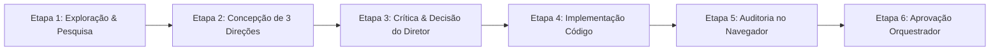

# ESTÚDIO CRIATIVO UNICFIT — DIRETRIZES PERMANENTES DE DIREÇÃO DE ARTE E DESIGN

> **Documento Institucional de Governança, Estrutura Multiagente e Manifesto Anti-Genérico**  
> **Worktree:** `feature/visual-ui` (`C:/Users/Willian/orca/workspaces/uni-fit/visual-ui/studio/`)  
> **Status:** Ativo e Permanente  
> **Supervisão:** Orquestrador Principal do Projeto Unicfit  

---

## 1. MANIFESTO CRIATIVO — COMBATE AO VISUAL GENÉRICO DE IA

O Estúdio Criativo da Unicfit existe para erradicar a mediocridade visual, o conforto dos templates prontos e os vícios repetitivos gerados por inteligências artificiais genéricas.

### Princípios Inegociáveis:
1. **A Unicfit é Real, Não um Mockup Fictício:** Toda decisão visual reverencia a arquitetura física da academia, a fachada real iluminada em neon roxo/magenta/azul, os equipamentos pesados de musculação e a localização estratégica em Macapá (bairros Congós e Santa Inês/Orla).
2. **Morte à Tirania dos Cards Idênticos:** Não aceitamos sites onde todas as seções são sequências monótonas de retângulos com bordas arredondadas e sombras roxas padrão. Cada seção deve ter um propósito narrativo, ritmo composicional e hierarquia tipográfica próprios.
3. **Assimetria e Tensão Visual:** O design esportivo de alto rendimento exige dinamismo, cortes angulares, contrastes agressivos entre escuridão profunda e laser luminescente, e tipografia monumental.
4. **Respeito ao Propósito Comercial:** Toda sofisticação estética existe para converter visitantes em alunos reais via WhatsApp e visitas presenciais. Beleza sem clareza comercial é rejeitada.

---

## 2. ESTRUTURA E PAPÉIS MULTIAGENTE DO ESTÚDIO

| Agente | Título | Especialidade & Atribuição Principal |
|---|---|---|
| **Agente 1** | **Creative Director** *(Diretor de Criação)* | Liderança do estúdio, curadoria artística, aprovação/rejeição de propostas, combate a clichês e garantia de coesão do Brand Book. |
| **Agente 2** | **Visual Researcher** *(Pesquisador Visual)* | Benchmarking de marcas esportivas globais (Equinox, Gymshark, Nike Training, On Running, Alo Yoga), fotografia editorial e tendências digitais. |
| **Agente 3** | **Brand & Art Designer** *(Designer de Marca e Arte)* | Guardião da identidade Unicfit, paletas cromáticas, geometria cortante inspirada no logotipo e composições gráficas exclusivas. |
| **Agente 4** | **Image & Photography Designer** *(Diretor de Imagem)* | Tratamento cromático, mascaramento de fotos reais (fachada e salão), contraste, sombras e integração das fotos ao layout sem emendas artificiais. |
| **Agente 5** | **UI/UX Designer** *(Designer de Interface e Experiência)* | Arquitetura de informação, ritmos de leitura, layouts não-convencionais, ergonomia mobile e fluxo de conversão. |
| **Agente 6** | **Motion & Interaction Designer** *(Designer de Movimento)* | Microinterações, transições cinéticas de viewport, física de hover, pulso luminoso e acessibilidade (`prefers-reduced-motion`). |
| **Agente 7** | **Frontend Design Implementer** *(Implementador Frontend)* | Materialização precisa dos conceitos aprovados em HTML5 semântico, CSS3 moderno com Design Tokens e JavaScript modular. |
| **Agente 8** | **Visual Quality Auditor** *(Auditor de Qualidade Estética)* | Inspeção rigorosa no navegador real, medição de contrastes, validação tipográfica, testes de responsividade e veto a imperfeições visuais. |

---

## 3. PROTOCOLO DE COLABORAÇÃO EM 6 ETAPAS

1. **Etapa 1 — Exploração:** Researcher traz referências de vanguarda; Brand Designer revisa a marca; Image Designer prepara os assets reais; UI/UX Designer mapeia atritos.
2. **Etapa 2 — Concepção:** Criação obrigatória de **3 direções visuais genuinamente distintas** (nunca apenas variações cosméticas da mesma ideia).
3. **Etapa 3 — Crítica e Seleção:** O Diretor de Criação e o Auditor examinam as propostas, descartam clichês e consolidam a direção vencedora.
4. **Etapa 4 — Implementação:** O Implementador Frontend constrói o código em `index.html` e `styles/`, guiado pelas especificações exatas.
5. **Etapa 5 — Validação:** Auditor inspeciona telas reais no navegador do Orca em viewports desktop e mobile, emitindo relatório.
6. **Etapa 6 — Aprovação:** Diretor de Criação homologa e entrega ao Orquestrador Principal do projeto.
